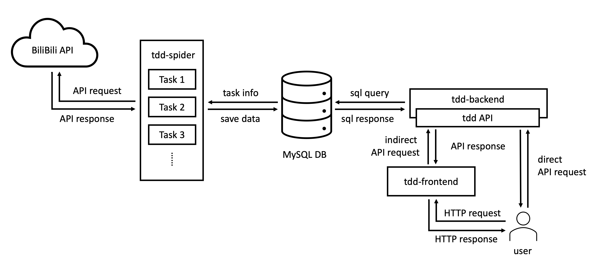

 English | [简体中文](./README_zh-CN.md)

```
CAUTION: This program is related to VOCALOID CHINA, so the most of the documentations are written in Chinese. Sorry for inconvenience.
```

<h1 align="center">
<b>tdd-spider</b>
</h1>

<div align="center">
Data acquisition program of TianDian Daily (<a href="https://tdd.bunnyxt.com">https://tdd.bunnyxt.com</a>) based on Python. Feel free to contact us via QQ group: <a href="https://jq.qq.com/?_wv=1027&k=588s7nw">537793686</a>！
</div>

## Introduction

[TianDian Daily](https://tdd.bunnyxt.com) is a personal project by bunnyxt designed to elevate the exchange of Vocaloid China-related data. Our goal is to offer comprehensive, easily accessible data and intuitive visualizations for all enthusiasts interested in Vocaloid China statistics.

The project is composed of three distinct components, all interconnected with a central database. These are:

- frontend: data presentation and interaction ([tdd-frontend](https://github.com/bunnyxt/tdd-frontend))
- backend: data access api ([tdd-backend](https://github.com/bunnyxt/tdd-backend))
- spider: original data collection（tdd-spider）

See the structure below.



## Collector runtime

The PostgreSQL collector uses Python 3.12 and parameterized SQL.

### Permanent setup (kept after migration)

1. Clone the repository and enter its directory.
2. Create a virtual environment with `python3.12 -m venv .venv`, then install the locked dependencies with `.venv/bin/python -m pip install -r requirements.txt`.
3. Copy `conf/conf.ini.example` to `conf/conf.ini` and configure `[db_postgresql]`. Copy `service/endpoints.json.example` to `service/endpoints.json` and configure your HTTP workers.
4. Install compatible business tables, partitions and maintenance triggers outside this repository, and grant the collector its business-table and identity-sequence permissions. The application does not create these objects. See [permanent setup](docs/postgresql.md#permanent-setup).
5. Prepare a restricted failure-file directory. Failed writes trigger a best-effort save of their input. Uncertain commits require manual database reconciliation; any resubmission is also manual, with no automatic replay or resubmission command. Never replay an earlier trial's failure files into a new baseline. See [failed writes](docs/postgresql.md#failed-writes).

### Migration-only setup (removed after wrap-up)

The current version requires migration protection even during formal collection.
Complete this setup before starting writers.

1. With collectors stopped, install `db/ingest.sql` as the database owner. It creates the migration-only `tdd_ingest.control` and `manifest` tables. Grant the collector schema `USAGE`, control `SELECT` and manifest `INSERT`, but no control mutations. See [migration-only setup](docs/postgresql.md#migration-only-setup); remove these objects and grants through [Retiring migration tooling](docs/postgresql.md#retiring-migration-tooling).
2. **Configure the control row before the first write.** The SQL installation leaves it empty, which rejects writes. Use `formal` with `active_run_id=NULL` and no `TDD_TRIAL_RUN_ID`, or `trial` with a non-NULL `active_run_id` and the identical `TDD_TRIAL_RUN_ID` in collector processes. The owner or maintenance role must follow [run control](docs/postgresql.md#migration-period-deployment-and-run-control). Retire this control and trial environment setting through [Retiring migration tooling](docs/postgresql.md#retiring-migration-tooling).
3. `TDD_ALLOW_UNMANAGED_INGEST=1` permits empty control only in disposable, one-off test databases. It is not for managed trials or formal deployments and cannot override an existing control row. Remove this test compatibility setting through [Retiring migration tooling](docs/postgresql.md#retiring-migration-tooling).
4. Keep `db/migration.py` and its two hooks: `transaction.write` calls `before_write`, and `append_rows` calls `record_keys`. Remove them with the temporary controls through [Retiring migration tooling](docs/postgresql.md#retiring-migration-tooling); do not drop their tables while the current implementation still needs them.

## Run records

Some scripts persist one structured row per run into a SQLite store
(`runrecord/`, `data/run-records.sqlite3`). Besides the CLI (`python -m
runrecord`, with `overview` and `trend` sub-commands), a **read-only** web page
gives an at-a-glance view:

- `/` — a per-script overview: one row per script with its latest run's status,
  duration and a few key metrics, plus a health banner.
- `/script/<name>` — one script's recent runs aligned into a per-run metric time
  series, with simple SVG line charts (key metrics + a built-in duration series;
  pick other metrics with the checkbox form). A missing run is a gap, never a
  zero; the charts show magnitude only and imply nothing about good or bad.
- `/runs` — the recent-runs stream, filterable by script, status and time.
- `/run/<id>` — one run in full: core fields, metrics grouped by scope, log paths.

Every page also serves `?format=json`.

It listens on `127.0.0.1` only, never writes, and has no auth. Start it in the
foreground on the host that holds the database, and reach it from a workstation
over an SSH tunnel (Ctrl-C on the server stops it):

```shell
# on the server
python3 -m runrecord.web \
  --host 127.0.0.1 \
  --port 8765 \
  --db data/run-records.sqlite3

# on the workstation
ssh -N -L 8765:127.0.0.1:8765 <server>
# open http://127.0.0.1:8765/
```

Or as a single command from the workstation:

```shell
ssh -t \
  -o ServerAliveInterval=30 \
  -o ServerAliveCountMax=3 \
  -L 8765:127.0.0.1:8765 <server> \
  'cd <project-directory> && exec python3 -m runrecord.web --host 127.0.0.1 --port 8765 --db data/run-records.sqlite3'
```

The PTY makes the foreground server follow the SSH session lifecycle, while
the keepalive options detect a dead connection instead of leaving it unnoticed.

### Snapshots

`runrecord.maintain` holds the snapshot command; the CLI and web
page above stay read-only.

```shell
# consistent gzipped snapshot + .sha256 into data/runrecord/
python3 -m runrecord.maintain backup

```

`backup` uses SQLite's online backup API rather than copying the live file, and
checks the copy with `PRAGMA integrity_check` before publishing it. Snapshots
accumulate until they are pulled off the host. The live run-record database has
no automatic age-based deletion. To restore a snapshot, verify and unpack it,
then point the CLI at the result before replacing anything:

```shell
sha256sum -c run-records_<stamp>.sqlite3.gz.sha256   # macOS: shasum -a 256 -c
gunzip -c run-records_<stamp>.sqlite3.gz > restored.sqlite3
python3 -m runrecord --db restored.sqlite3 overview
```
